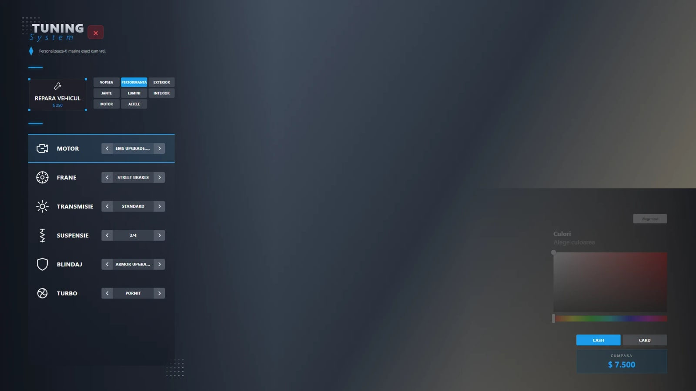
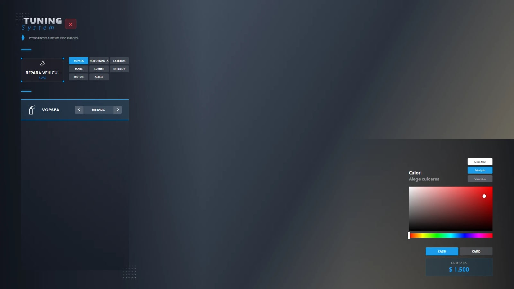

# PULSE-TUNING

**Tune absolutely everything on a vehicle, with a live color picker and a camera that follows the part.**

  

[**Get it on Discord**](https://discord.gg/czRymmEfuS) &nbsp;•&nbsp; [**All Pulse Store products**](https://github.com/amiculap/pulse-portfolio)

> 🔒 This page is a **showcase**. The source code is private and is delivered only after purchase.

---

## Overview

PULSE-TUNING lets players tune absolutely everything on their vehicle: engine, brakes, transmission, suspension, armor and turbo, plus exterior, interior and engine bay parts. It is **standalone**, so it works with vRP, ESX, QBCore or no framework at all.

## Preview

  
  

## Highlights

- 🧩 **Standalone** — Works with vRP, ESX, QBCore or no framework.
- 🎨 **Live color picker** — Custom RGB colors with instant preview.
- 🚗 **Adapts to the car** — Only what the vehicle supports is shown.
- 💳 **Cash or card** — Players pay the way your server allows.

## Features

### Framework & database

- **Standalone**: works with **vRP**, **ESX**, **QBCore** or no framework at all
- Compatible with **MongoDB**, **oxmysql**, **mysql-async**, **ghmattimysql** (or no database)

### Tuning

- Engine, brakes, transmission, suspension, armor, turbo
- Exterior, interior and engine bay parts, liveries, extras, neon and tyre smoke
- Custom RGB colors with a live color picker
- Options adapt to each vehicle, only what the car supports is shown

### Economy

- Pay with **cash** or **card**
- Prices set by the server, with per-level pricing for performance parts

### Persistence & interface

- Modifications saved per plate and applied automatically
- Modern interface with a camera that follows the selected part

### Setup

- Everything configurable from a single `config.lua`
- Support included after purchase

## Compatibility

| | |
| :-- | :-- |
| **Frameworks** | vRP · ESX · QBCore · standalone |
| **Databases** | MongoDB · oxmysql · mysql-async · ghmattimysql · none |
| **Payment** | Cash or card |
| **Configuration** | Single `config.lua` |

## What you get

- The complete resource, tested and fully functional
- Support after purchase through the official ticket system
- Free updates for bug fixes
- A license for your server / community

## Get it

**Price: 10€**

1. Join the [Pulse Store Discord](https://discord.gg/czRymmEfuS)
2. Open a ticket in **#tickets**
3. Tell us what you need and get the details

Payments: bank transfer, Revolut, LTC, Paysafe.

---

[← Back to the Pulse Store portfolio](https://github.com/amiculap/pulse-portfolio) &nbsp;•&nbsp; © 2026 Pulse Store — all rights reserved. See [LICENSE](LICENSE).

